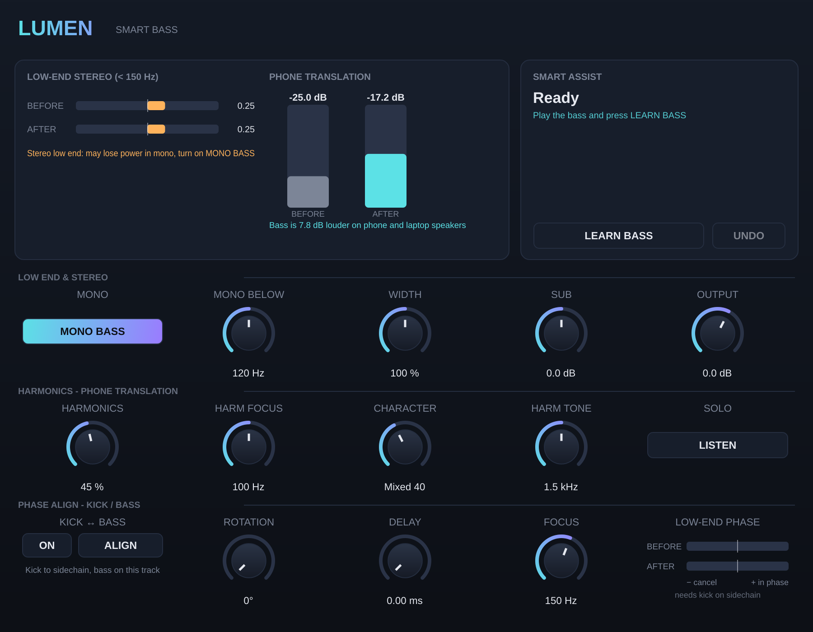

# Lumen Bass — Smart Bass (VST3 / AU)

A low-end tool for EDM, part of the Lumen series: mono bass, phone translation and kick/bass phase alignment.

## Low end and stereo
- **MONO BASS** + **Mono Below** (20–500 Hz): everything below becomes mono. Phase-coherent M/S processing (LR4), so the stereo image above the split is untouched. Measured: 50 Hz side −30 dB, 2 kHz side unchanged.
- **Width** (0–200 %) for the stereo above the split
- **Sub:** low shelf at 60 Hz (±12 dB)
- The **Low-end stereo** meter shows < 150 Hz correlation before and after (1.0 = mono-safe)

## Harmonics (phone translation)
Phones and laptops can't play below ~150 Hz, so a sub bass disappears on them. Lumen Bass generates exact 2nd/3rd/4th harmonics (Chebyshev polynomials) from the low band:
- **Harmonics:** amount. **Harm Focus:** which low band they're generated from. **Character:** Warm (even) ↔ Edgy (odd). **Harm Tone:** how high the harmonics reach
- Harmonics track the bass level exactly (the same ratio at −6 dB and at −26 dB)
- **LISTEN:** hear only the harmonics being added
- The **Phone translation** meter shows how many dB louder the bass becomes on a phone speaker

## Phase Align (kick ↔ bass)
The same as in Lumen Compressor: route the kick to the sidechain, press **ALIGN**, and it sets Rotation (0–360°) and Delay to line up the low end. The **LOW-END PHASE** meter shows before and after.

## Smart Assist — LEARN BASS
Listens to the bass for 4 s, measures its fundamental (accurate to ±0.3 Hz) and how much energy sits below 100 Hz, then sets **Mono Below**, **Harm Focus**, **Harmonics** and **Character**. **UNDO** restores the previous settings.

## Tested
- pluginval strictest level: **SUCCESS**
- With everything neutral the plugin is completely transparent (deviation < 1e-7)
