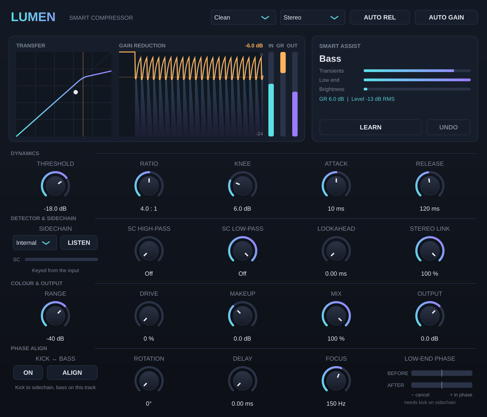

# Lumen Compressor — Smart Compressor (VST3 / AU)

Lumen serijos kompresorius su keturiais charakteriais, pilnu sidechain'u, lookahead, Mid/Side režimu ir Smart Assist. Veikia macOS (VST3 + AU) ir Windows (VST3).

## Stiliai (STYLE)
| Stilius | Detektorius | Charakteris |
|---|---|---|
| **Clean** | Peak, feed-forward | Skaidrus, tikslus (VCA / mastering tipo) |
| **Opto** | RMS, feedback | Švelnus, nuo programos priklausomas release (vokalui, bosui) |
| **FET** | Peak, feedback | Greitas, agresyvus, su harmonikomis (būgnams, „punch'ui“) |
| **Vari-Mu** | RMS, platus knee | Ratio auga su lygiu, „klijuoja“ (busams, padams) |

Statinė kreivė visuose stiliuose tiksli ±0,05 dB (feedback stiliams ratio kompensuojamas automatiškai).

## Valdikliai
- **Dynamics:** Threshold, Ratio (1:1 … ∞:1 limiter), Knee (0–24 dB), Attack (0,02–200 ms), Release (5 ms–2 s)
- **AUTO REL:** dviejų pakopų release, greitas po tranzientų ir lėtas po ilgo spaudimo
- **Sidechain:** Internal arba External (kitas takelis), SC High-Pass / Low-Pass (pvz. kad kick'as „nepumpuotų“ viso miksto), **LISTEN** leidžia girdėti, ką girdi detektorius
- **Lookahead** (0–10 ms) sugauna tranzientus prieš jiems įvykstant. DAW automatiškai kompensuoja vėlavimą
- **Stereo Link** (0–100 %) ir **Mid/Side** režimas (atskirai spaudžia vidurį ir šonus)
- **Range** riboja maksimalų gain reduction
- **Drive** suteikia švelnią saturaciją (FET stilius visada turi šiek tiek)
- **Makeup** + **AUTO GAIN** (lyginama tikra išėjimo ir įėjimo garsumas, o ne apytikslė formulė)
- **Mix** leidžia daryti paralelinę (New York) kompresiją, **Output**

## Phase Align (kick ↔ bass)
Išsprendžia kick'o ir boso fazių konfliktą, kai žemi dažniai vienas kitą „suvalgo“.
1. Uždėk Lumen Compressor ant **boso** takelio, o **kick'ą** nukreipk į sidechain įėjimą (kaip aprašyta žemiau).
2. Paleisk vietą, kur kick ir bosas groja kartu, ir spausk **ALIGN**. Per ~4 s pluginas analizuoja žemų dažnių juostą.
3. Jis pats nustato **Rotation** (fazės pasukimą 0–360°, įskaitant poliarumą) ir **Delay** (0–10 ms) bei įjungia **ON**.
4. **LOW-END PHASE** indikatorius rodo koreliaciją prieš ir po: kairėje (oranžinė) reiškia, kad garsai vienas kitą naikina, dešinėje (žydra) reiškia, kad jie fazėje.

**Focus** nustato, kurią dažnių juostą lyginti (numatyta 150 Hz; sub-bosui galima mažinti iki 60–80 Hz). Rotation ir Delay galima reguliuoti ir rankomis, klausantis rezultato.
Fazės pasukimas naudoja Hilberto allpass filtrus: amplitudė nepakinta, o fazės tikslumas yra ±1° nuo 20 Hz (44,1/48 kHz).
Kompresorius dirba su jau sulygintu bosu, todėl kick'o sidechain spaudimą galima naudoti kartu.

## Ekranas
- **TRANSFER:** kompresijos kreivė su threshold žyme ir gyvu signalo tašku
- **GAIN REDUCTION:** ~6 s istorija (įėjimo lygis ir GR), dabartinė GR reikšmė dB
- **IN / GR / OUT** indikatoriai

## Smart Assist
**LEARN** klauso ~6 s, atpažįsta medžiagą ir išmatuoja jos lygį bei dinamiką. Tada nustato stilių, ratio, attack/release, SC filtrą ir **threshold pagal tikrą įrašo lygį**, kad gautųsi tinkamas spaudimas:
- Vokalas: Opto 3:1, ~5 dB GR
- Būgnai: FET 4:1, lėtesnis attack, kad praeitų tranzientai
- Bosas: Opto 4:1
- Padai: Vari-Mu 2:1, ~2,5 dB
- Visas miksas: Clean 2:1 „glue“, SC HP 90 Hz, ~2 dB

Slenkstis parenkamas teisingai nepriklausomai nuo to, ar takelis įrašytas garsiai, ar tyliai. Įjungiamas AUTO GAIN. **UNDO** grąžina ankstesnius nustatymus.

## Sidechain Ableton programoje
1. **SIDECHAIN** perjunk į **External**.
2. Ableton įrenginio antraštėje išskleisk **Sidechain** (▸), įjunk jį ir laukelyje **Audio From** pasirink takelį (pvz. Kick).
3. **LISTEN** leidžia išgirsti raktinį signalą, o SC filtrais gali palikti tik reikiamą dažnių juostą.

## Testuota
- Kompiliuojasi be įspėjimų; pluginval griežčiausiu lygiu (strictness 10): **SUCCESS**
- Statinė kreivė ±0,05 dB; ∞:1 limiter tiksliai laiko threshold; lookahead 5 ms sumažina persišokimą nuo 19,6 dB iki 0,1 dB
- Latency tiksliai lygi lookahead'ui; dry kelias sulygintas (paralelinė kompresija be fazės problemų)
