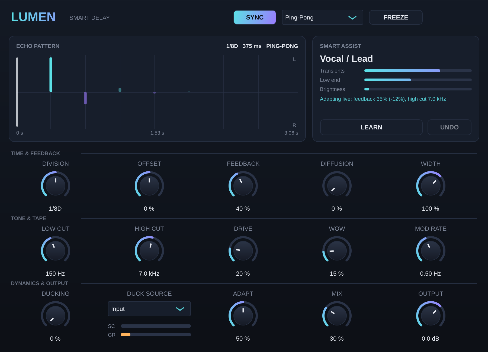

# Lumen Delay — Smart Delay (VST3 / AU)

Lumen serijos delay su „Smart Assist“, tempo sync, ping-pong, tape charakteriu ir **sidechain ducking'u**. Veikia macOS (VST3 + AU) ir Windows (VST3).

## Galimybės
- **Sync / Time**: nuo 1/32 iki 1 takto (yra ir triplet bei dotted dalijimai) arba laisvas laikas nuo 1 ms iki 2 s
- **Mode**: Stereo, Ping-Pong arba Mono. **Offset** pakeičia dešiniojo kanalo laiką ±50 %
- **Feedback** iki 100 % (savaiminė osciliacija išlieka saugi), **Freeze** sukuria begalinį pasikartojimą
- **Tone & Tape**: Low/High Cut kartojimuose, **Drive** (juostos saturacija), **Wow** (wow/flutter moduliacija), **Diffusion** (išsklaidyti, „debesuoti“ kartojimai)
- **Ducking** su pasirenkamu šaltiniu:
  - *Input*: delay patyli, kai groja pats takelis
  - *Sidechain*: delay patyli pagal **kitą takelį** (pvz., kick ar vokalą). Rodomi SC lygio ir GR (kiek prislopinta) indikatoriai
- **Smart Assist**: **LEARN** atpažįsta medžiagą ir parenka dalijimą, režimą, feedback'ą ir tonaciją pagal DAW tempą. **Adapt** prisitaiko gyvai: esant greitai medžiagai mažina feedback'ą ir didina ducking'ą, ryškesnį signalą daro tamsesnį

## Sidechain Ableton Live programoje
1. Uždėk Lumen Delay ant takelio ar Return takelio.
2. Plugino lange **DUCK SOURCE** perjunk į **Sidechain**, o **Ducking** pasuk iki ~50 %.
3. Ableton įrenginio antraštėje išskleisk **Sidechain** skiltį (mažas trikampis ▸), įjunk ją ir laukelyje **Audio From** pasirink takelį, pvz., *Kick* arba *Vocal*.
4. Kai šaltinis groja, SC indikatorius juda, o delay prislopsta.

## Įdiegimas
- **Windows:** `Lumen Delay.vst3` aplanką nukopijuok į `C:\Program Files\Common Files\VST3\`
- **macOS:** `.vst3` → `~/Library/Audio/Plug-Ins/VST3/`, `.component` → `~/Library/Audio/Plug-Ins/Components/`, tada paleisk:
  `xattr -cr ~/Library/Audio/Plug-Ins/VST3/"Lumen Delay.vst3" ~/Library/Audio/Plug-Ins/Components/"Lumen Delay.component"`

## Testuota
- Kompiliuojasi be įspėjimų; pluginval griežčiausiu lygiu (strictness 10): **SUCCESS** (įskaitant sidechain bus išdėstymus)
- Echo laikas tikslus iki mėginio; esant 100 % feedback signalas išlieka ribotas; staigūs laiko pokyčiai neduoda NaN ir šuolių
