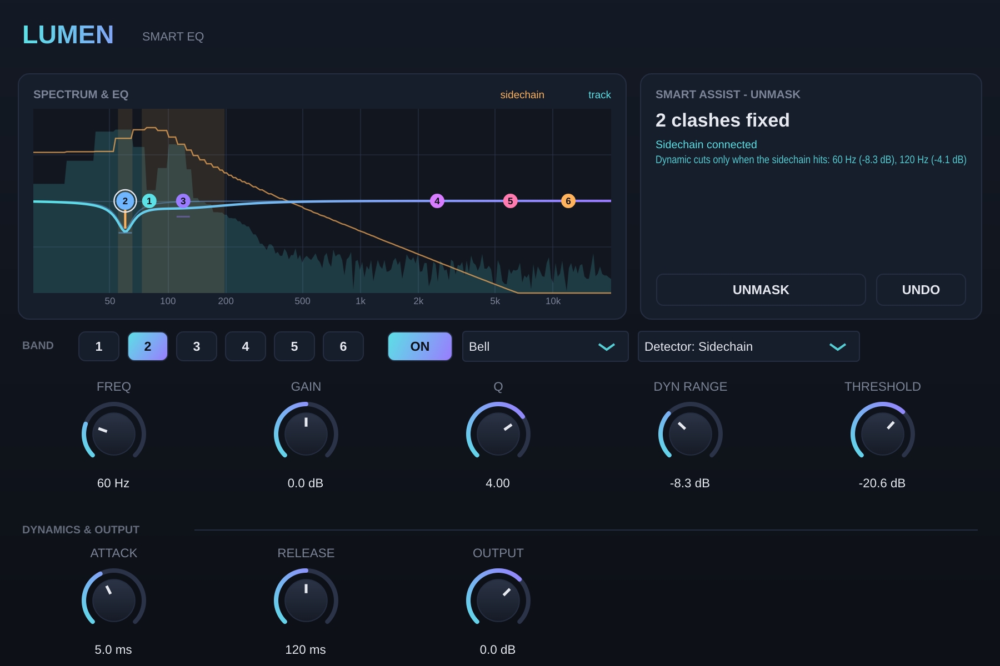

# Lumen EQ — Smart Dynamic EQ (VST3 / AU)

A 6-band dynamic EQ with automatic unmasking, part of the Lumen series.

## EQ
- **6 bands:** Bell, Low Shelf, High Shelf, Low Cut, High Cut, Notch
- Drag a dot on the graph to change frequency and gain; the mouse wheel changes Q. You can also use the **Freq / Gain / Q** knobs
- A live **spectrum** of the track (cyan) with the **sidechain** spectrum overlaid (orange)
- Accuracy: neutral = 0.000 dB; a +6 dB bell = +6.00 dB measured

## Dynamic bands
- **Dyn Range** (−24…+24 dB): how much the band moves. Negative cuts when the signal goes over the threshold; positive boosts
- **Threshold** and a **Detector** per band: **Internal** (the track itself, e.g. de-essing or taming resonances) or **Sidechain** (another track, e.g. the kick)
- **Attack / Release** are shared by all bands
- The graph shows the dynamic movement live (an orange line from the static to the current gain)

## Smart Assist — UNMASK
For example, carving the bass out of the kick's way:
1. Put Lumen EQ on the **bass**, and route the **kick** to the sidechain (Ableton: expand **Sidechain** in the device header, then **Audio From** = Kick).
2. Play a section with both and press **UNMASK**.
3. Over 4 s it compares both spectra (1/6-octave), finds where they clash (up to 3 places) and sets free bands to **dynamic cuts driven by the sidechain**: the bass is cut there **only when the kick hits**, and keeps its full body between hits.
4. **UNDO** restores the previous settings.

Test: with a 55 Hz bass and a kick, UNMASK found 60 Hz (−8.3 dB) and 120 Hz (−4.1 dB); during the kick the 60 Hz band cut 7.2 dB live.

## Tested
- pluginval strictest level: **SUCCESS**
