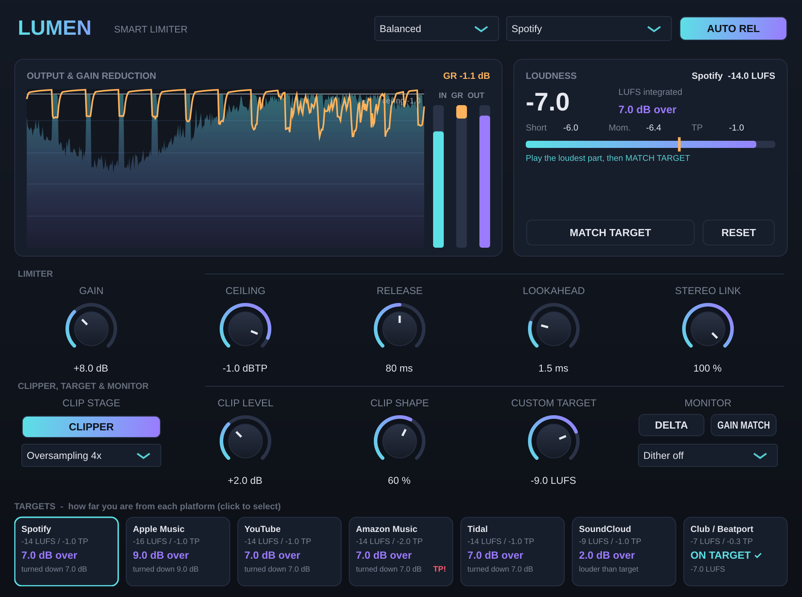

# Lumen Limiter — Smart Limiter (VST3 / AU)

A true-peak mastering limiter with a clipper stage, BS.1770 loudness metering and platform targets, part of the Lumen series.

## Limiter
- **True-peak detection** (4× windowed-sinc interpolation) plus a lookahead design: the gain is guaranteed to have reached the needed level by the time the peak arrives. Tested: output true peak ≤ ceiling at every setting.
- **Gain** (0 to +24 dB), **Ceiling** (dBTP), **Release**, **AUTO REL** (two-stage: fast after transients, slow after sustained limiting), **Lookahead** (0.5–5 ms), **Stereo Link**
- **Style:** Transparent / Balanced / Loud

## Clip stage
- **CLIPPER** before the limiter shaves the sharpest peaks so the limiter works less (louder with fewer artefacts)
- **Oversampling 1×, 2×, 4×, 8×, 16×** (FIR, linear phase). At 16× the clipping is practically alias-free
- **Clip Level** (how far above the ceiling the clipper starts) and **Clip Shape** (soft ↔ hard)

## Loudness and targets
- **Integrated / Short-term / Momentary LUFS** (ITU-R BS.1770-4, EBU R128 gating) and **True Peak max**
- **Targets strip:** every platform at once (Spotify, Apple Music, YouTube, Amazon Music, Tidal, SoundCloud, Club/Beatport) showing **how much you're missing** ("+2.3 dB to go"), "ON TARGET ✓", or how far over you are (and how much the platform will turn the track down). **TP!** warns when the true peak is above that platform's ceiling. Click a card to select that target.
- **Custom Target** for your own LUFS value
- **MATCH TARGET** (Smart Assist): play the loudest section, and Gain adjusts itself every 2 s until the short-term loudness hits the selected target

## Monitoring and output
- **DELTA:** hear only what the clipper and limiter remove
- **GAIN MATCH:** compare at equal loudness (turns the output down by the Gain amount)
- **Dither:** TPDF at 16 or 24 bit (use only on the final export)

## Tested
- pluginval strictest level (strictness 10): **SUCCESS**
- True peak at every oversampling setting (1–16×), clipper on and off: max −1.02 dBTP at a −1.0 ceiling
- LUFS matches the EBU reference (−20 dBFS stereo sine = −20.0 LUFS), gating is correct
- Latency 79–146 samples (1.6–3 ms at 48 kHz); the DAW compensates automatically
