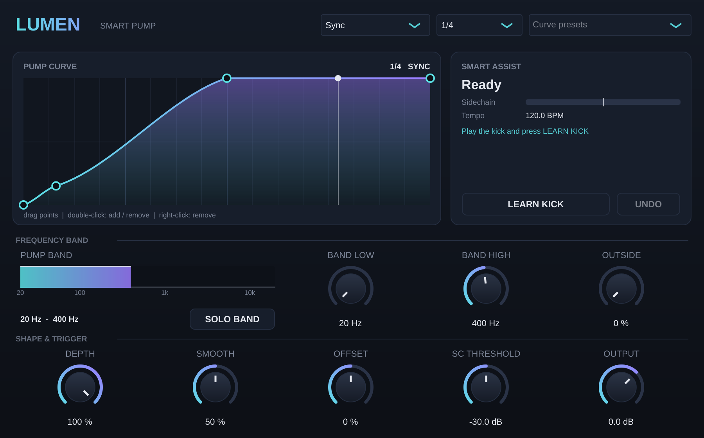

# Lumen Pump — Smart Pump (VST3 / AU)

A frequency-selective volume shaper for sidechain pumping, part of the Lumen series. Runs on macOS (VST3 + AU) and Windows (VST3).

## Frequency-selective pumping
The signal is split into 3 bands with phase-coherent Linkwitz-Riley crossovers (the sum is perfectly flat: 0.00 dB):
- **Band Low / Band High** set which range pumps (for example 20–400 Hz)
- **Depth** sets how deep the band pumps
- **Outside** sets how much everything else pumps (0 % = not at all)
- **SOLO BAND** lets you hear only the pumping band while you set it

Measured with a 20–400 Hz band at 100 % depth: 60 Hz pumps 21.8 dB, 1 kHz moves 0.2 dB, 3 kHz doesn't move.

## Trigger
- **Sync:** follows the DAW grid (1/16 … 2 bars, with triplets). **Offset** shifts the curve within the cycle.
- **Sidechain:** route the kick to the sidechain input and every hit starts the curve (fills and breaks are followed automatically). **SC Threshold** sets sensitivity, and the white mark on the Sidechain meter shows the threshold.
- **MIDI:** every note starts the curve.

## Curve editor
- Drag points; **double-click** adds or removes a point; **right-click** removes one
- **Smooth** rounds the transitions
- 20 presets: Classic Pump, Hard Cut, Short Duck, Snappy, Soft Pump, Big Room, Deep House Bounce, Long Swell, Future Bass Swell, Lo-fi Breathe, Double Pump, Kick + Snare, Off-Beat Lift, Trance Gate, Triplet Chop, 1/16 Stutter, Pre-Duck Ramp, Saw Fall, Sine Wave, Flat
- The curve is saved with the project

## Smart Assist — LEARN KICK
Listens to the kick for 4 s (from the sidechain, or from this track if nothing is connected), measures its decay and fundamental, then:
- fits the curve so the duck lasts exactly as long as the kick body (at the current tempo and rate)
- sets the band from 20 Hz up to ~5× the kick fundamental (150–500 Hz)
- switches on Sidechain trigger if a sidechain is connected
- **UNDO** restores the previous settings

## Ableton Live
- **Sidechain:** in the device header expand **Sidechain** (▸), turn it on and pick the kick track under **Audio From**. In the plugin choose **Trigger → Sidechain**.
- **MIDI:** on a MIDI track set **MIDI To** to the track with Lumen Pump, then **Lumen Pump**. In the plugin choose **Trigger → MIDI**.

## Tested
- Builds without warnings; pluginval strictest level (strictness 10): **SUCCESS**
- Crossovers flat to 0.00 dB from 30 Hz to 15 kHz; Sync aligned to the sample with the DAW beat; Sidechain trigger latency 0.35 ms
