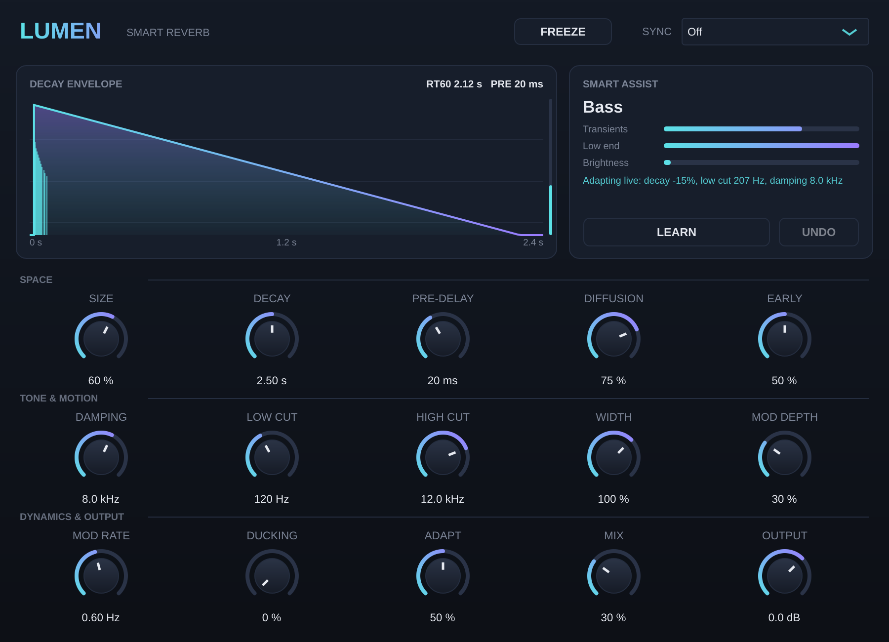

# Lumen Reverb — Smart Reverb (VST3 / AU)



Aukštos kokybės algoritminis reverbas su „Smart Assist“ funkcija. Veikia **macOS** (VST3 + AU, Apple Silicon ir Intel) ir **Windows** (VST3).

## Kas viduje

**Garso variklis**
- 16 linijų *Feedback Delay Network* su Hadamard matrica: tankus, lygus uodegos skambesys be metalinio atspalvio
- Moduliuotos vėlinimo linijos (kubinė interpoliacija), todėl uodega gyva ir be „žvangėjimo“
- 12 ankstyvųjų atspindžių, kurių erdvė keičiasi kartu su „Size“
- Įėjimo difuzija, dažninis slopinimas (Damping), Low/High Cut, Stereo Width
- Tikslus RT60: „Decay“ reikšmė atitinka išmatuotą uodegos trukmę (±2 %)
- Freeze (begalinė uodega), Ducking (reverbas „atsitraukia“, kai groja signalas)
- Tempo Sync: uodegos ilgis pagal DAW tempą (1/4 … 4 taktai)

**Smart Assist („AI“ dalis)**
- Realiu laiku analizuoja signalą: tranzientus, žemus dažnius, ryškumą, dinamiką
- Atpažįsta medžiagą: *Drums, Bass, Vocal/Lead, Pad, Full Mix*
- **LEARN**: paleisk takelį, paspausk mygtuką, ir per ~6 s pluginas parinks visus nustatymus pagal medžiagą ir DAW tempą. **UNDO** grąžina ankstesnius nustatymus.
- **Adapt**: reverbas prisitaiko gyvai. Esant greitiems tranzientams, uodega trumpėja ir daugiau ducking'o; esant ryškiam signalui, uodega tamsesnė; esant daug žemų dažnių, low cut kyla, kad miksas nebūtų purvinas.
- Kai Mix ≥ 95 % (naudojama kaip send/aux), LEARN Mix nekeičia.

> Pastaba: Smart Assist — tai signalo analizės ir taisyklių sistema, ne treniruotas neuroninis tinklas. Ji veikia akimirksniu, nenaudoja CPU šuolių ir nereikalauja interneto.

## Kaip gauti paruoštus plugin failus (be programavimo)

1. Susikurk nemokamą paskyrą [github.com](https://github.com).
2. Sukurk naują repozitoriją (pvz. `LumenReverb`) ir įkelk visus šio aplanko failus (*Add file → Upload files*). **Svarbu:** turi būti įkeltas ir aplankas `.github`.
3. Atidaryk skirtuką **Actions**. Build prasidės automatiškai ir truks ~10–15 min.
4. Kai abu darbai (macOS ir Windows) taps žali, atidaryk paskutinį paleidimą ir apačioje skiltyje **Artifacts** atsisiųsk:
   - `LumenReverb-macOS`: `Lumen Reverb.vst3` ir `Lumen Reverb.component`
   - `LumenReverb-Windows`: `Lumen Reverb.vst3`

## Įdiegimas

**Windows**
- `Lumen Reverb.vst3` aplanką nukopijuok į `C:\Program Files\Common Files\VST3\`
- DAW programoje paleisk plugin'ų paiešką (rescan)

**macOS**
- `Lumen Reverb.vst3` → `~/Library/Audio/Plug-Ins/VST3/`
- `Lumen Reverb.component` → `~/Library/Audio/Plug-Ins/Components/`
- Pluginas nepasirašytas Apple sertifikatu, todėl vieną kartą paleisk Terminal:
  ```
  xattr -cr ~/Library/Audio/Plug-Ins/VST3/"Lumen Reverb.vst3"
  xattr -cr ~/Library/Audio/Plug-Ins/Components/"Lumen Reverb.component"
  ```
- Logic Pro: jei pluginas nesimato, perkrauk Logic arba paleisk `killall -9 AudioComponentRegistrar`

## Kompiliavimas pačiam (nebūtina)

Reikia CMake ≥ 3.22 ir Xcode (Mac) arba Visual Studio 2022 (Windows). JUCE atsisiunčiamas automatiškai.

```
cmake -B build -DCMAKE_BUILD_TYPE=Release
cmake --build build --config Release
```

## Valdikliai

| Valdiklis | Ką daro |
|---|---|
| Size | Erdvės dydis (atspindžių ir linijų ilgiai) |
| Decay | Uodegos trukmė RT60 (0,2–20 s) |
| Pre-Delay | Tarpas prieš reverbą, kad vokalas liktų aiškus |
| Diffusion | Atakos tankis (mažai = grūdėta, daug = lygu) |
| Early | Ankstyvųjų atspindžių garsumas |
| Damping | Kaip greitai gęsta aukšti dažniai uodegoje |
| Low / High Cut | Reverbo EQ |
| Width | Stereo plotis (0–150 %) |
| Mod Depth / Rate | Uodegos moduliacija (gyvumas, chorus efektas) |
| Ducking | Reverbo prislopinimas, kai groja signalas |
| Adapt | Kiek stipriai Smart Assist keičia garsą gyvai |
| Mix / Output | Sauso ir šlapio signalo santykis, išėjimo lygis |

Dvigubas paspaudimas ant valdiklio grąžina numatytąją reikšmę.

## Testuota

- Pilnas kompiliavimas be klaidų ir įspėjimų
- [pluginval](https://github.com/Tracktion/pluginval) griežčiausiu lygiu (strictness 10): **SUCCESS**
- DSP stabilumas: nėra NaN, freeze režimas stabilus, RT60 tikslumas ±2 %
