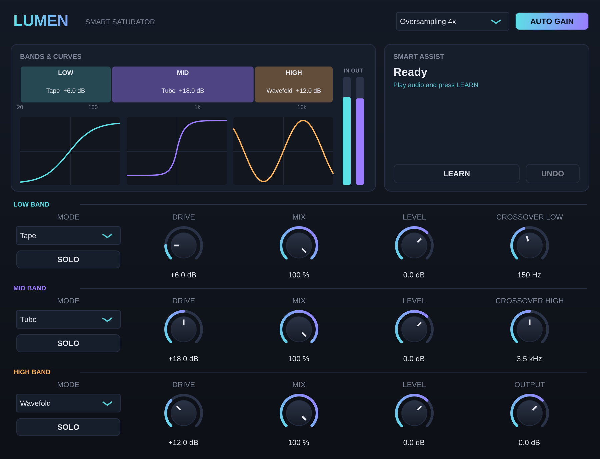

# Lumen Saturator — Smart Saturator (VST3 / AU)

A 3-band saturator for drums, bass and leads, part of the Lumen series.

## Bands
- **LOW / MID / HIGH**, split by phase-coherent Linkwitz-Riley crossovers (the dry sum is perfectly flat: 0.000 dB)
- **Crossover Low** (40 Hz–1 kHz) and **Crossover High** (1–12 kHz)
- Per band: **Mode**, **Drive** (0–36 dB), **Mix** (parallel saturation), **Level**, **SOLO**
- Band isolation: driving the mid band leaves the low band completely clean (−120 dB distortion)

## Modes
| Mode | Character |
|---|---|
| **Tape** | soft, smooth, a touch of even harmonics |
| **Tube** | asymmetric, warm 2nd harmonic |
| **Soft Clip** | cubic, round clipping |
| **Hard Clip** | hard, aggressive, punchy |
| **Wavefold** | the waveform folds back: metallic, synth-style harmonics |

## Quality
- **Oversampling 1×, 2×, 4×, 8×, 16×** (linear-phase FIR). Clean saturation with no aliasing
- **AUTO GAIN** keeps each band as loud as it was, so you judge the colour, not the volume (at 24 dB drive, output equals input within 0.1 dB)
- A DC blocker in each band (Tube/Tape asymmetry)

## Smart Assist — LEARN
Listens for about 6 s, recognises the material (drums, bass, vocal/lead, pad, full mix) and sets modes, drive, mix and crossovers. **UNDO** restores the previous settings.

## Tested
- pluginval strictest level: **SUCCESS**
